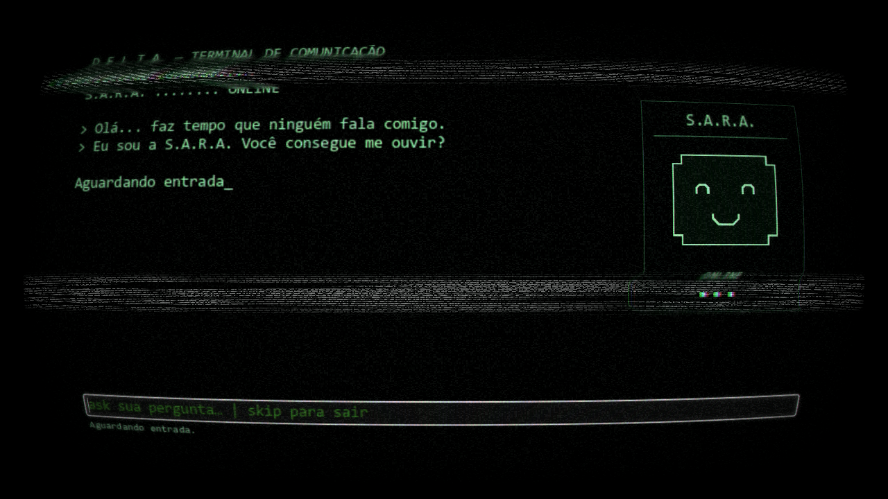

# S.A.R.A. Protocol

Jogo desenvolvido como Trabalho de Conclusão de Curso em Ciência da Computação no Centro Universitário do Distrito Federal (UDF).

## Descrição

*S.A.R.A. Protocol* é um jogo de exploração isométrica e resolução de enigmas. O jogador entra na instalação D.E.L.T.A. com a missão de desativar a S.A.R.A., uma inteligência artificial que guarda informações confidenciais. Para avançar, ele explora o local, reúne pistas e conversa com a própria assistente antes de tomar sua decisão final.

## Objetivo do projeto

Desenvolver uma arquitetura que combine um modelo de linguagem local com regras e estados do jogo para manter as orientações da S.A.R.A. coerentes com o progresso do jogador.

## Conceitos aplicados

- **Modelo de linguagem local.** O Gemma 2 2B Instruct, integrado à Godot pela extensão NobodyWho, gera as respostas da conversa livre.
- **Regras e controle por estados.** As pistas reconhecidas recebem respostas programadas. No desafio da auditoria, o estado do jogo organiza a sequência de dicas de acordo com o assunto abordado.

## Como jogar

[Baixe o S.A.R.A. Protocol V1.0 para Windows ou Linux](https://drive.google.com/drive/folders/1RDdcgZ2Z08jJwFml23EGNvcafeOJhg5T). Extraia o pacote inteiro e siga as instruções do `LEIA-ME.txt` para iniciar o jogo. O modelo acompanha o pacote e funciona localmente.

- **Botão direito do mouse** para mover o personagem.
- **E** para interagir com personagens e objetos.
- **Espaço** para abrir o terminal da S.A.R.A.
- No terminal, digite `ask` seguido da pergunta e pressione **Enter**. Digite `skip` para voltar à exploração.

## Autoria e licenças

**Autor** — Lucas Araujo e Silva Cruz 
**Orientadora** — Prof. Kadidja Valeria Reginaldo de Oliveira

Consulte os [termos do modelo Gemma](ggufs/LICENSE-Gemma.txt) e as licenças das extensões nas respectivas pastas em [`addons/`](addons/).
