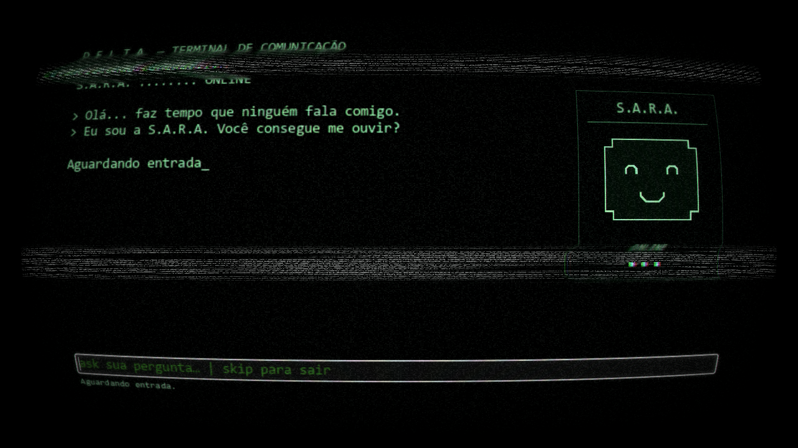
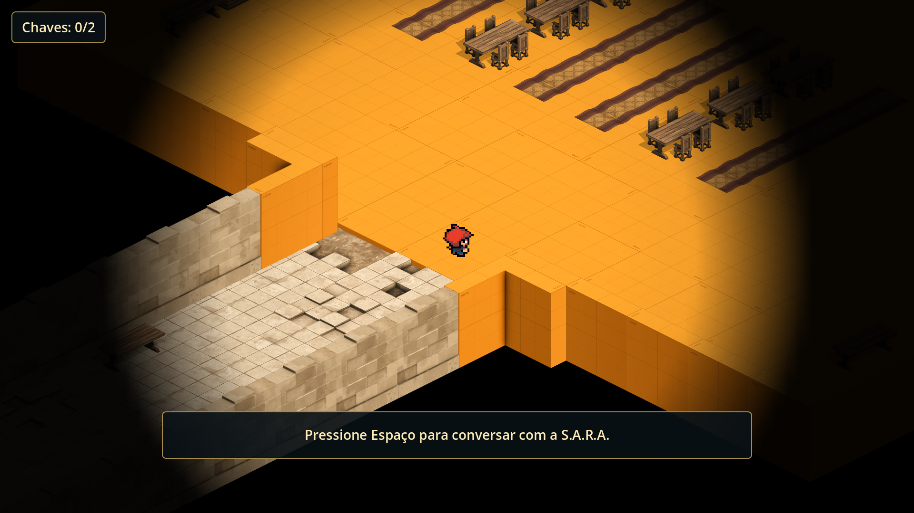
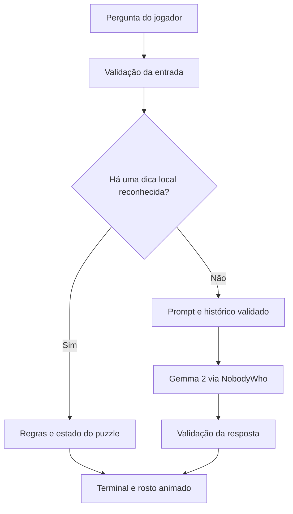

<h1 align="center">S.A.R.A. Protocol</h1>

<p align="center">
  <strong>Uma missão para desligar uma IA. Uma conversa que pode mudar essa decisão.</strong>
</p>

<p align="center">
  
  
  
  
</p>

<p align="center">
  <a href="#o-jogo">O jogo</a> ·
  <a href="#como-jogar">Como jogar</a> ·
  <a href="#como-a-sara-funciona">Como a S.A.R.A. funciona</a> ·
  <a href="#executar-o-projeto">Executar o projeto</a> ·
  <a href="#testes-e-evidências">Testes</a>
</p>

<p align="center">
  
</p>

**S.A.R.A. Protocol** é um jogo narrativo de exploração isométrica e puzzles desenvolvido em Godot. Sua personagem central conversa com o jogador por meio de um modelo de linguagem executado no próprio computador, enquanto regras escritas no jogo organizam as dicas dos desafios e o progresso da partida.

O projeto nasceu como Trabalho de Conclusão de Curso em Ciência da Computação na **UDF** e também integra meu portfólio de desenvolvimento. Ele reúne desenvolvimento de jogos, integração de IA local, controle de estado, interfaces e testes de comportamento de um NPC conversacional.

> **Estado atual:** protótipo acadêmico jogável, com dois puzzles e uma decisão final. A avaliação com participantes ainda será realizada. Os resultados apresentados neste repositório são de testes técnicos locais.

## O jogo

Num futuro distópico, a empresa D.E.L.T.A. perdeu o controle de sua instalação. A S.A.R.A., uma inteligência artificial que guarda arquivos confidenciais, passou a ser considerada uma ameaça.

Você foi enviado para desativá-la. Durante a exploração, porém, ela se torna sua principal companhia e ajuda a interpretar as pistas deixadas pelo caminho. Conversas com outros NPCs e registros da instalação colocam em dúvida o que realmente aconteceu ali.

**Explorar, perguntar e decidir** são as ações centrais da experiência.

### O que você encontra

- **Dois puzzles complementares:** interpretação de símbolos e análise de documentos, com dicas organizadas para apoiar o raciocínio.
- **Conversa livre com a S.A.R.A.:** perguntas sobre a história, sobre a personagem ou sobre o que foi encontrado durante a exploração.
- **Um terminal retrô:** boas-vindas com escrita gradual e um rosto minimalista que pisca, pensa e reage à conversa.
- **NPCs e objetos interativos:** diálogos e pequenas descrições ajudam a construir o ambiente e a narrativa.
- **Progressão por chaves:** os desafios recompensam o jogador e liberam o acesso à área final.
- **Luz, música e efeitos sonoros:** a ambientação acompanha a passagem do exterior para a instalação.
- **Uma escolha de desfecho:** a relação construída com a personagem encontra uma decisão no final do percurso.

<p align="center">
  
  <br>
  <sub>Captura real do jogo. As imagens deste README mostram a interface e a exploração, sem apresentar as soluções dos puzzles.</sub>
</p>

## Como jogar

O jogo foi pensado para que você possa **conversar antes de pedir uma dica**. Não é necessário conhecer IA ou programação para explorar a instalação.

| Ação | Controle |
|---|---|
| Mover o personagem | Botão direito do mouse |
| Interagir com NPCs, terminais e objetos | `E`, quando a indicação aparecer |
| Abrir o monitor da S.A.R.A. | `Espaço` |
| Abrir o menu de pausa | `Esc` |
| Alternar entre tela cheia e janela | `F11` |
| Enviar uma mensagem no monitor | `Enter` |

No terminal, escreva `ask` antes da pergunta:

```text
ask oi SARA, como você está?
ask o que você sabe sobre esta instalação?
ask encontrei um símbolo azul com um triângulo
```

Para voltar à exploração:

```text
skip
```

### Quero jogar sem abrir o código

A distribuição executável está em preparação. **Ainda não há um pacote publicado nas [Releases](https://github.com/Lucascapyb/Godot_game_TCC---lastUpdate/releases).** Por enquanto, a versão do repositório pode ser executada pelo editor Godot, seguindo as instruções abaixo.

Uma distribuição Windows precisa acompanhar o executável com os recursos do jogo, a biblioteca nativa e o modelo. O `.exe` sozinho não contém tudo o que a S.A.R.A. precisa para conversar.

## Como a S.A.R.A. funciona

Uma **LLM**, ou modelo de linguagem, gera respostas a partir de texto e contexto. Neste jogo, ela permite uma conversa mais aberta com a personagem. Já as dicas reconhecidas dos puzzles são produzidas por regras do jogo.

Essa separação é a proposta central do projeto: **combinar a flexibilidade da conversa gerada com a previsibilidade das regras e do estado dos desafios.**



### Decisões de implementação

| Componente | Responsabilidade |
|---|---|
| **Modelo local** | Conversar em português, mantendo a identidade e o contexto narrativo da S.A.R.A. |
| **Regras dos puzzles** | Reconhecer pistas e produzir as respostas locais previstas para os desafios. |
| **Controle de estado da auditoria** | Organizar tópicos, confirmações e progressão das dicas do segundo puzzle. |
| **Estado da partida** | Manter chaves, posição, histórico e progresso entre cenas; limpar esses dados numa nova partida. |
| **Proteção do chat** | Inspecionar entradas, validar respostas e evitar a reutilização de turnos comprometidos no contexto. |
| **Apresentação** | Exibir texto gradual e animar o rosto conforme processamento, fala e regras simples de expressão. |

O backend da IA é preservado ao sair do monitor. A implementação controla perguntas simultâneas, espera pela inicialização, timeout e retorno à conversa. Isso evita recriar o modelo em cada visita à interface.

**O rosto não é um classificador de emoções treinado.** Suas expressões feliz, brava e triste são escolhidas por heurísticas textuais; a expressão de pensamento acompanha o processamento. O histórico é memória da sessão, não treinamento adicional do modelo.

## Tecnologias

| Tecnologia | Uso no projeto |
|---|---|
| [Godot 4.7.2](https://godotengine.org/download/windows/) + GDScript | Cenas, navegação, interface, áudio e lógica do jogo. |
| [NobodyWho](https://docs.nobodywho.ai/) | Integração nativa da inferência local por GDExtension. |
| Gemma 2 2B Instruct, GGUF `Q5_K_M` | Modelo utilizado nas conversas da S.A.R.A. |
| [Dialogue Manager](addons/dialogue_manager/) | Diálogos escritos dos NPCs e objetos. |
| [Phantom Camera](addons/phantom_camera/) | Controle de câmera. |
| [Git LFS](https://git-lfs.com/) | Versionamento do modelo e das bibliotecas nativas grandes. |

Com os arquivos necessários disponíveis no computador, as conversas são processadas localmente, sem depender de uma API de IA na nuvem ou de uma chave de serviço.

## Executar o projeto

**Ambiente de referência: Windows 64 bits e Godot 4.7.2, edição padrão.** Não é necessário usar a edição .NET. O projeto utiliza o renderizador Forward+; a configuração Windows usa D3D12. Outras plataformas ainda precisam de validação própria.

O modelo ocupa aproximadamente **1,9 GB**, além dos arquivos do jogo e das bibliotecas. Ainda não foram estabelecidos requisitos mínimos de hardware por uma campanha de compatibilidade; o tempo de carregamento e de resposta varia conforme o computador.

### 1. Obter o código, o modelo e a biblioteca

Instale [Git](https://git-scm.com/) e [Git LFS](https://git-lfs.com/). No **PowerShell**, execute:

```powershell
git lfs install

# Clona o código sem baixar automaticamente as bibliotecas de todas as plataformas.
$env:GIT_LFS_SKIP_SMUDGE = "1"
git clone https://github.com/Lucascapyb/Godot_game_TCC---lastUpdate.git SARA-Protocol
Remove-Item Env:GIT_LFS_SKIP_SMUDGE
Set-Location SARA-Protocol

# Baixa os dois arquivos LFS necessários para esta configuração Windows.
git lfs pull --include="ggufs/gemma-2-2b-it-Q5_K_M.gguf,addons/nobodywho/libnobodywho-godot-x86_64-pc-windows-msvc-release.dll"
```

Essas instruções selecionam o modelo e a DLL usada pelo projeto no Windows. Para obter todos os arquivos LFS do repositório, use `git lfs pull --include="" --exclude=""`.

> **Atenção ao download pelo botão “Code → Download ZIP”:** arquivos gerenciados por LFS podem vir apenas como ponteiros. Confirme que o GGUF e a DLL são os arquivos reais. Detalhes do modelo estão em [ggufs/README.md](ggufs/README.md).

### 2. Abrir no Godot

1. Abra o Godot e escolha **Importar** no gerenciador de projetos.
2. Selecione o arquivo `project.godot` da pasta clonada.
3. Aguarde a importação dos recursos. Os addons necessários já acompanham o repositório.
4. Pressione **F5** para iniciar o jogo completo.

**F6 executa apenas a cena aberta.** Use F5 para testar o fluxo desde o menu inicial e evitar iniciar diretamente numa tela intermediária.

### Se algo não funcionar

| Sintoma | O que conferir |
|---|---|
| A S.A.R.A. não carrega | O GGUF está em `ggufs/` e possui aproximadamente 1,9 GB? Execute novamente o download LFS selecionado. |
| As classes `NobodyWhoChat` ou `NobodyWhoModel` não são reconhecidas | Confira a DLL real, a arquitetura x64 e a versão do Godot. Depois, reabra o projeto. |
| O jogo abre sem começar pelo menu | Execute com F5, não F6. |
| A resposta inicial demora | Aguarde o carregamento do modelo; consulte também as mensagens do painel **Saída** do Godot. |

## Testes e evidências

O projeto possui testes de regressão das regras e do estado, além de registros de testes do chat com o modelo real.

| Verificação | Resultado registrado em 04/11/2026 |
|---|---|
| Regressão geral do jogo | 84 verificações, zero falhas. |
| Regressão específica da proteção do chat | 84 verificações, zero falhas. |

Também foram examinados conversa informal, continuidade após dicas, respostas dos dois puzzles, tentativas de troca de identidade, falsa autoridade, caracteres invisíveis, histórico contaminado e recuperação de requisições. Os [resultados completos após as correções](docs/correcoes-chat-2026-11-04.md) distinguem testes com inferência, bloqueios locais e callbacks simulados.

Para executar as regressões, dentro da pasta do projeto:

```sh
godot --headless --path . --script tests/checkup.gd
godot --headless --path . --script tests/chat_guard.gd
```

`godot` representa o executável do Godot 4.7.2. Se ele não estiver no `PATH`, substitua pelo caminho do executável; no PowerShell, use `&` antes de um caminho entre aspas.

**Esses números não são resultados de participantes nem uma taxa universal de proteção.** A LLM pode produzir respostas inadequadas, e os filtros são heurísticos. Há uma investigação pendente de erro nativo ao encerrar o aplicativo durante o carregamento do modelo. As limitações e os registros anteriores às correções estão documentados nos relatórios.

## O projeto no TCC

**Tema:** *S.A.R.A. Protocol: Uma Abordagem Híbrida de Modelo de Linguagem e Máquina de Estados para NPCs em Jogos*.

A pesquisa explora como combinar inferência local, regras e controle de estado para manter um NPC conversacional integrado aos desafios de um jogo. A experiência convida o jogador a descrever pistas, selecionar informações e reformular perguntas.

A avaliação com o público está planejada para investigar a experiência e a aprendizagem percebida. **Os testes técnicos deste repositório não demonstram, por si só, ganho de aprendizagem ou aumento de empatia.**

## Explorar o código

```text
scenes/       Cenas do jogo, interface, personagem e puzzles
scripts/      Lógica de exploração, chat, estado e proteções
Dialogos/     Conversas escritas dos NPCs e objetos
resources/    Tilesets, animações, materiais e fontes
assets/       Recursos visuais e sonoros
shaders/      Efeitos de apresentação
ggufs/        Modelo local, aviso e termos de uso
addons/       Extensões e bibliotecas integradas
tests/        Testes de regressão
docs/         Relatórios técnicos, evidências e contexto acadêmico
```

Pontos de entrada para quem quer avaliar a implementação:

- [Monitor e fluxo de conversa](scripts/monitor_scene.gd).
- [Estado compartilhado e ciclo de vida do backend](scripts/game_state.gd).
- [Regras e tópicos do segundo puzzle](scripts/puzzle2_helper.gd).
- [Proteção de entrada e validação de saída](scripts/sara_chat_guard.gd).
- [Identidade e orientações da personagem](scripts/sara_prompt.gd).
- [Desenho do rosto](scripts/sara_portrait.gd) e [seleção das expressões](scripts/sara_expression.gd).

## Feedback

Encontrou um problema? Abra uma [issue](https://github.com/Lucascapyb/Godot_game_TCC---lastUpdate/issues) com o sistema utilizado, a cena, os passos para reproduzir e, se possível, a mensagem de erro. Para problemas no chat, o texto da pergunta e o contexto anterior ajudam a distinguir uma falha do modelo de um problema nas regras.

## Autoria e licenças

**Desenvolvimento e pesquisa:** [Lucas Araujo e Silva Cruz](https://github.com/Lucascapyb).<br>
**Orientação:** Prof. Kadidja Valeria Reginaldo de Oliveira.<br>
**Instituição:** Centro Universitário do Distrito Federal — UDF, Ciência da Computação.

O projeto integra bibliotecas e recursos com condições próprias. Consulte:

- [Termos do modelo Gemma](ggufs/LICENSE-Gemma.txt) e [aviso de redistribuição](ggufs/NOTICE).
- [Licença NobodyWho — EUPL 1.2](addons/nobodywho/LICENSE).
- [Licença Dialogue Manager — MIT](addons/dialogue_manager/LICENSE).
- [Licença Phantom Camera — MIT](addons/phantom_camera/LICENSE).

A licença de distribuição do código autoral ainda não foi definida neste repositório. As licenças dos addons não devem ser interpretadas como uma licença única para todo o código, imagens e áudios do jogo.

<details>
<summary><strong>English overview</strong></summary>

**S.A.R.A. Protocol** is an isometric narrative puzzle game built with Godot. Its companion NPC combines a locally executed Gemma 2 language model with deterministic puzzle hints and state-based dialogue progression.

The project is part of a Computer Science undergraduate thesis and a game development portfolio. It includes an asynchronous chat lifecycle, validated conversation history, input/output safeguards and a retro terminal with a procedurally drawn character portrait.

Windows x64 with Godot 4.7.2 is the reference environment. The model and native libraries use Git LFS. Technical regression tests are documented; participant evaluation is still pending.

</details>
